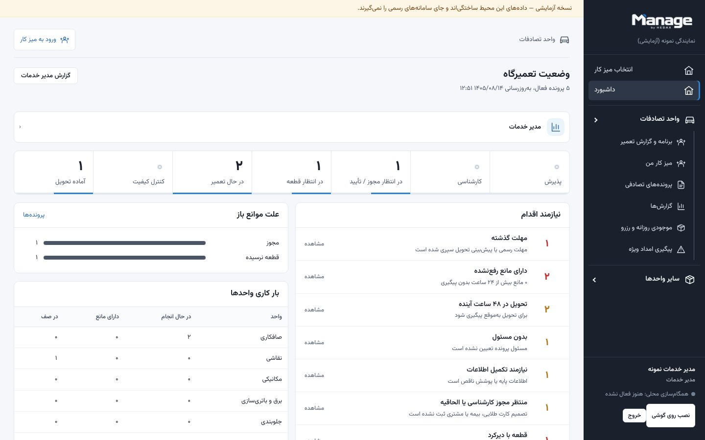
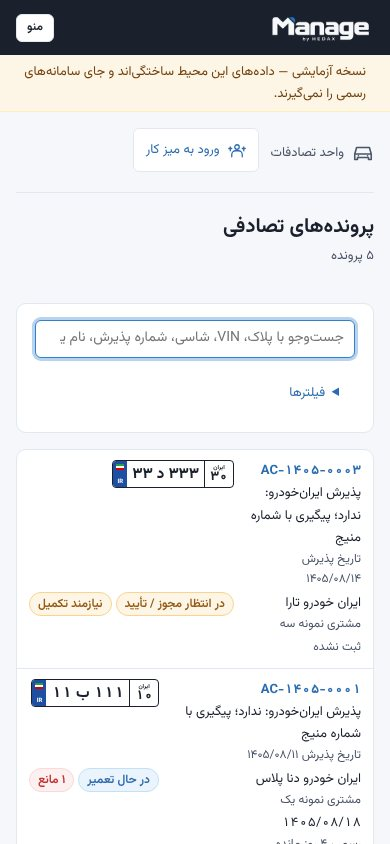

<div align="center">


### From intake to delivery, in full view.

One platform for the daily operations of a car dealership

[فارسی](README.md) · [Architecture](docs/ARCHITECTURE.md) · [API](docs/API.md) · [Roadmap](docs/ROADMAP.md) · [Documentation](docs/README.md) · [Progress](PROGRESS.md)

</div>

Manage is an **internal, complementary** system for a dealership. It does not replace the official systems of the manufacturer or of roadside assistance. Every accident-repair vehicle has one clear route, each person sees only their own work, and the service manager sees where the bottleneck is. Manage **records** official approvals; it never issues them. The interface is Persian and right-to-left, and the data model has had room for several dealerships and several brands from the first day.

**Single source of truth:** the [product specification](docs/PRODUCT_SPEC_FA.md) (Persian) and the [approved mockups](docs/design/mockups/). Where code or another document differs from the specification, the specification is right.

**Status:** the first module (accident repair) is in use at an Iran Khodro dealership in Qom. Release notes are in [CHANGELOG.md](CHANGELOG.md) and the current state in [PROGRESS.md](PROGRESS.md).

<p align="center">
  
  &nbsp;
  
  <br><sub>Screenshots use synthetic data.</sub>
</p>

## Six roles

| Role | Main work | Sign-in |
| --- | --- | --- |
| Accident expert (several people) | Intake, assessment and supplements, repair plan and labour fees, approving the end of each station's work, final check, advance payment, statement and handover | Username + 4-digit PIN |
| Parts officer | Deciding the source of every part, reservation, special-assistance orders, market purchase, pricing, outside work, final statement | Username + 4-digit PIN |
| Station technician | Start and finish of work, "I have no part", reminders; on a phone | Username + 4-digit PIN |
| Service manager | View, analysis and reminders only (the control room) | Username + 4-digit PIN |
| System administrator | Unblocking work, fixing errors, setting limits, uploading reports, acting in place of any role | Email + password + Google Authenticator |
| Owner | All access and the sensitive actions; a flag on an account, not a separate role | Through the system administrator door |

## A vehicle's route

Intake → coverage type (golden card, insurance, personal) → assessment → **two tracks in parallel:** parts supply (parts officer) and the repair route (expert and technicians) → final statement (parts officer) → close (accident expert).

| Area | What Manage does |
| --- | --- |
| Intake and assessment | Official or manual intake; assessment and supplements entered one by one or imported from Excel with a preview and duplicate protection |
| Parts | **One parts list per vehicle**; reservation from stock by the 8+2-digit code, special-assistance order with its request number, market purchase; special-assistance status read automatically from the daily report; handover to the station; returns and cancellations with a reason |
| Stock | Usable stock = today's report − active reservations − parts handed over on open cases |
| Repair | Steps in any order (station, days, fee, person); the technician starts and finishes, the expert approves |
| Alerts and reminders | Parts-cost alert with an adjustable limit, late special assistance, behind plan; reminders from anyone to anyone; no alert ever blocks work |
| Control room | Four headline numbers, route funnel and bottleneck, live workshop map, today's analysis, performance by person |

Accounts are created by private invitation. Staff sign in with a 4-digit PIN; administrators use a personal password and Google Authenticator. See the [sign-in guide](docs/PERSONAL_AUTH_FA.md) and [staff and access](docs/STAFF_FA.md) (both Persian).

## Run locally (no Docker, no PostgreSQL install)

Requires Node.js 22 or later and pnpm 10.

```bash
git clone https://github.com/ali-hedax/manage-dealership-platform.git
cd manage-dealership-platform
git switch main
pnpm install --frozen-lockfile
pnpm dev
```

- Web: <http://localhost:3000>. API health: <http://localhost:4000/api/v1/health>.
- The first run creates a sample dealership with entirely synthetic data. The demo usernames and their shared password are written to `apps/api/.data/demo-credentials.local.txt`, which is not tracked by Git.
- The local database is PGlite (embedded PostgreSQL) in `apps/api/.data/`. To start again: `pnpm --filter @manage/api build && pnpm db:reset-demo`.

## Local preview build (for testing in a browser)

```bash
pnpm install
pnpm preview
```

- Address: <http://localhost:3100> (production build, persistent synthetic data). Demo passwords are in `apps/api/.data/preview/credentials.local.txt`.
- `pnpm preview --reset` rebuilds the sample data; `pnpm preview --lan` lets a phone on the same network open it.

## Full stack on PostgreSQL (Docker)

```bash
cp .env.example .env    # set POSTGRES_PASSWORD and SEED_DEMO_PASSWORD
docker compose up -d --build
```

Web listens on `WEB_PORT` (default 3000). Details and security notes: [DEPLOYMENT.md](docs/DEPLOYMENT.md).

## Tests

```bash
pnpm test        # unit and integration tests (API on embedded PostgreSQL)
pnpm build
pnpm test:e2e    # Playwright; on Windows it uses the installed Edge
```

Results of the latest run: [TEST_REPORT.md](docs/TEST_REPORT.md).

## Layout

```
apps/api         NestJS + Drizzle + PostgreSQL: business rules, access control, audit
apps/web         Next.js: Persian right-to-left interface
packages/shared  Shared contracts: roles and permissions, validation, Jalali dates
docs/            Product specification, architecture, database, deployment, guides
legacy/          The earlier single-file prototype, kept unchanged
```

The current product does not depend on the prototype in `legacy/`; see the [feature migration plan](docs/PROTOTYPE_MIGRATION.md).

## Documentation

The [documentation index](docs/README.md) lists every guide by audience. Most used: [product specification](docs/PRODUCT_SPEC_FA.md) · [architecture](docs/ARCHITECTURE.md) · [database](docs/DATABASE.md) · [API](docs/API.md) · [workflows](docs/WORKFLOWS.md) · [deployment](docs/DEPLOYMENT.md) · [backup and restore](docs/BACKUP_RESTORE.md) · [roadmap](docs/ROADMAP.md) · [security](SECURITY.md) · [contributing](CONTRIBUTING.md) · [changelog](CHANGELOG.md).

## HEDAX

Manage is one of two HEDAX products, alongside [Source by HEDAX](https://github.com/ali-hedax/source-auto-parts-platform), the auto parts store and custom sourcing service. Both follow the [HEDAX brand guide](https://github.com/ali-hedax/brand-guide-hedax).

## Rights

© HEDAX. All rights reserved. No open-source license is granted; the code and the brand may not be redistributed. Maintainer: [Ali Hedayatshodeh](https://github.com/ali-hedax).
