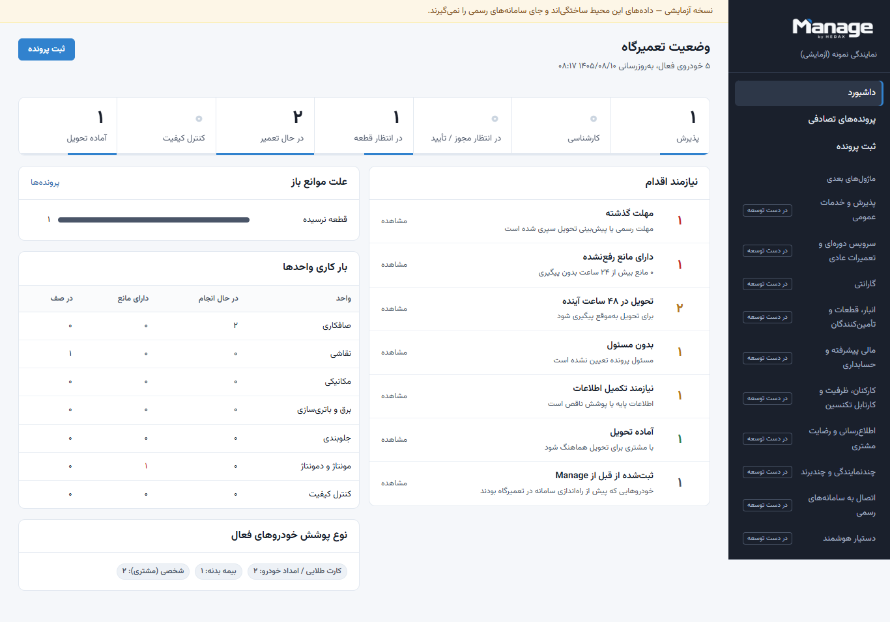

# Manage by HEDAX

**پلتفرم مدیریت عملیات نمایندگی خودرو — فاز اول: خودروهای تصادفی**

[English](README.en.md) · [معماری](docs/ARCHITECTURE.md) · [راهنمای کاربر](docs/USER_GUIDE_FA.md) · [وضعیت پیشرفت](PROGRESS.md) · [نقشه راه](docs/ROADMAP.md)

> **وضعیت: نسخه آزمایشی اول (Preview).** فقط با داده ساختگی اجرا شده است. هنوز روی سرور نمایندگی نصب نشده، به سامانه‌های رسمی (خودروساز، امداد، بیمه، انبار، حسابداری) وصل نیست و حالت آفلاین/همگام‌سازی هنوز فعال نشده است. جزئیات دقیق در [PROGRESS.md](PROGRESS.md).



## چه کاری انجام می‌دهد

Manage پرونده هر خودروی تصادفی را از پذیرش تا تحویل دنبال می‌کند تا مدیر خدمات و سرپرست تصادفات در هر لحظه بدانند هر خودرو کجاست، منتظر چیست و چه کسی باید اقدام کند.

| قابلیت | وضعیت |
| --- | --- |
| ورود با نقش‌های جدا و کنترل دسترسی سمت سرور | فعال |
| ثبت پرونده، خودرو و مالک؛ جست‌وجو با پلاک، VIN، نام، تلفن یا شماره پرونده | فعال |
| نوع پوشش: کارت طلایی، بیمه بدنه، شخصی، ترکیبی، نامشخص | فعال (فیلدهای پایه) |
| سه زمان مستقل: مهلت رسمی، پیش‌بینی داخلی، تحویل واقعی | فعال |
| ثبت خودروهایی که از قبل در تعمیرگاه بوده‌اند با تاریخ پذیرش گذشته | فعال |
| فعالیت‌های تعمیر به تفکیک واحد، وابستگی، شروع/مانع/اتمام/تأیید سرپرست | فعال |
| ثبت مانع با زمان بروز، زمان ثبت، پیگیری و رفع | فعال |
| داشبورد مدیر متصل به فهرست‌های فیلترشده | فعال |
| تاریخچه غیرقابل‌حذف (Audit) | فعال |
| کارشناسی و الحاقیه، قطعات، گیت مالی، QC، گزارش و PDF | تحویل دوم و سوم |
| سرور محلی + همگام‌سازی ابری، حالت آفلاین | پس از بررسی سرور نمایندگی |

## اجرای محلی (بدون Docker و بدون نصب PostgreSQL)

پیش‌نیاز: Node.js 22 یا جدیدتر و pnpm 10.

```bash
pnpm install
pnpm dev
```

- وب: <http://localhost:3000> و API: <http://localhost:4000/api/v1/health>
- در اولین اجرا یک نمایندگی نمونه با داده کاملاً ساختگی ساخته می‌شود. نام‌های کاربری (`expert`، `supervisor`، `manager`، `parts`، `cashier`، `qc`، `admin`) و رمز مشترک در فایل `apps/api/.data/demo-credentials.local.txt` نوشته می‌شود؛ این فایل در Git ثبت نمی‌شود.
- پایگاه داده محلی PGlite (PostgreSQL تعبیه‌شده) در `apps/api/.data/` است. برای شروع دوباره: `pnpm --filter @manage/api build && pnpm db:reset-demo`.

## اجرای کامل با PostgreSQL (Docker)

```bash
cp .env.example .env    # POSTGRES_PASSWORD و SEED_DEMO_PASSWORD را تعیین کنید
docker compose up -d --build
```

وب روی پورت `WEB_PORT` (پیش‌فرض ۳۰۰۰). جزئیات و نکات امنیتی در [DEPLOYMENT.md](docs/DEPLOYMENT.md).

## آزمون

```bash
pnpm test        # آزمون واحد و یکپارچه (API روی PostgreSQL تعبیه‌شده)
pnpm build
pnpm test:e2e    # Playwright؛ روی ویندوز از Edge نصب‌شده استفاده می‌کند
```

نتیجه آخرین اجرا در [TEST_REPORT.md](docs/TEST_REPORT.md).

## ساختار

```
apps/api         NestJS + Drizzle + PostgreSQL — قواعد کسب‌وکار، دسترسی، Audit
apps/web         Next.js — رابط فارسی راست‌به‌چپ
packages/shared  قراردادهای مشترک: نقش‌ها و مجوزها، اعتبارسنجی، تاریخ شمسی
docs/            معماری، پایگاه داده، فرایندها، استقرار، امنیت، آزمون
index (4).html   نمونه اولیه قدیمی داشبورد انبار (دست‌نخورده؛ پایین را ببینید)
```

## نمونه اولیه قبلی

فایل `index (4).html` نمونه اولیه تک‌فایلی تحلیل موجودی و پذیرش است و شاخه‌های `feature/b2b-auto-report` و `feature/nobat-dahi` روی آن کار کرده‌اند. این نسخه بدون تغییر حفظ شده و محصول جدید به آن وابسته نیست. وضعیت شاخه‌ها و PRها در [GITHUB_AUDIT.md](docs/GITHUB_AUDIT.md).

## مستندات

[AGENTS.md](AGENTS.md) · [PROGRESS.md](PROGRESS.md) · [CHANGELOG.md](CHANGELOG.md) · [CONTRIBUTING.md](CONTRIBUTING.md) · [SECURITY.md](SECURITY.md) · [ARCHITECTURE](docs/ARCHITECTURE.md) · [DATABASE](docs/DATABASE.md) · [WORKFLOWS](docs/WORKFLOWS.md) · [OFFLINE_SYNC](docs/OFFLINE_SYNC.md) · [DEPLOYMENT](docs/DEPLOYMENT.md) · [BACKUP_RESTORE](docs/BACKUP_RESTORE.md) · [ROADMAP](docs/ROADMAP.md) · [چک‌لیست سرور برای IT](docs/IT_SERVER_CHECKLIST_FA.md)

## حقوق

نگهدارنده: [ali-hedax](https://github.com/ali-hedax). این مخزن مجوز متن‌باز ندارد؛ عمومی‌بودن مخزن به‌معنای اجازه بازنشر کد یا هویت برند نیست. نوع مجوز با تصمیم مالک تعیین می‌شود.
