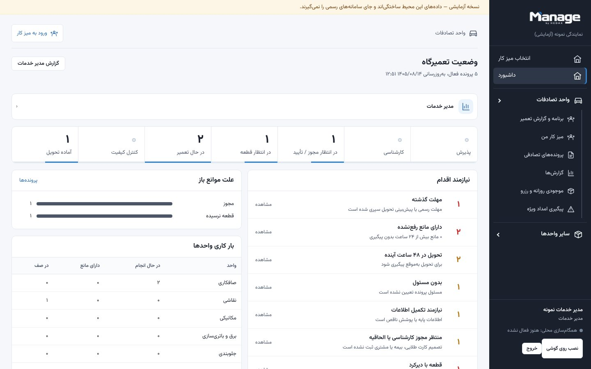
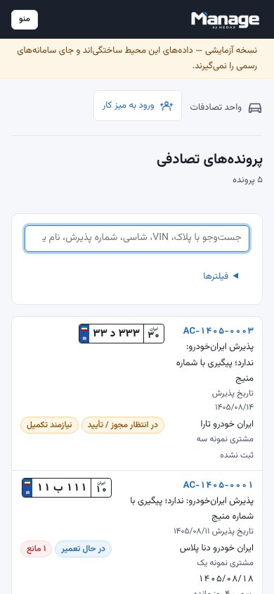

<div align="center">


### از پذیرش تا تحویل، با دید روشن.

سامانهٔ یکپارچهٔ مدیریت عملیات نمایندگی‌های خودرو

[English](README.en.md) · [راهنمای کاربر](docs/USER_GUIDE_FA.md) · [معماری](docs/ARCHITECTURE.md) · [API](docs/API.md) · [نقشهٔ راه](docs/ROADMAP.md) · [وضعیت پیشرفت](PROGRESS.md)

</div>

Manage هر خودرو را از پذیرش تا تحویل دنبال می‌کند تا مدیر خدمات، سرپرست تصادفات، کارشناس، انبار، صندوق و کنترل کیفیت هر لحظه بدانند هر خودرو کجاست، منتظر چیست و چه کسی باید اقدام کند. رابط فارسی و راست‌به‌چپ است و از روز اول برای چند نمایندگی و چند برند طراحی شده است.

**وضعیت:** ماژول اول (خودروهای تصادفی) در یک نمایندگی ایران‌خودرو در حال استفاده و آزمون است. اتصال به سامانه‌های رسمی (خودروساز، امداد، بیمه، حسابداری) و حالت آفلاین در [نقشهٔ راه](docs/ROADMAP.md) است. جزئیات هر انتشار در [CHANGELOG.md](CHANGELOG.md).

<p align="center">
  
  &nbsp;
  
  <br><sub>داشبورد مدیر خدمات و فهرست پرونده‌ها روی گوشی؛ تصاویر با دادهٔ ساختگی.</sub>
</p>

## مسیر یک خودرو

| مرحله | آنچه Manage انجام می‌دهد |
| --- | --- |
| پذیرش و پرونده | ثبت خودرو و مالک، جست‌وجو با پلاک، VIN، شاسی، نام، تلفن یا شمارهٔ پرونده؛ ورود خودروهای موجود از اکسل؛ نوع پوشش (کارت طلایی، بیمه بدنه، شخصی، ترکیبی) |
| کارشناسی و مجوز | کارشناسی و الحاقیه با نسخه‌بندی، ورود برآورد از اکسل، ثبت مجوز رسمی و تأیید جزئی اقلام |
| قطعات و تأمین | نیاز قطعه از کارشناسی، سفارش و زمان رسیدن، رسید و کنترل، رزرو از موجودی روزانه، گزارش امداد ویژه، صف مغایرت |
| تعمیر و جایگاه‌ها | برنامهٔ تعمیر کدگذاری‌شده به تفکیک واحد و جایگاه، شروع، مانع، اتمام و تأیید سرپرست؛ تقویم کاری و تعطیلات |
| مالی | سهم پرداخت‌کنندگان، پیش‌پرداخت با تأیید مدیر و صندوق، استثنا با سقف، تسویه |
| کنترل کیفیت و تحویل | کنترل کیفیت با کار اصلاحی، بستن فنی و مالی جدا، تحویل خودرو و بایگانی |
| مدیریت | میز کار هر نقش، داشبورد «نیازمند اقدام»، گزارش‌ها با خروجی PDF و Excel، سه زمان مستقل (مهلت رسمی، پیش‌بینی داخلی، تحویل واقعی) |
| امنیت و دسترسی | نقش‌ها و مجوزهای قابل تنظیم با کنترل سمت سرور، ورود با ایمیل و Google Authenticator، تاریخچهٔ غیرقابل‌حذف، نصب روی گوشی (PWA) |

ورود کارکنان: دعوت خصوصی، انتخاب رمز شخصی، اتصال Google Authenticator. [راهنمای ورود](docs/PERSONAL_AUTH_FA.md) · [کارکنان و دسترسی‌ها](docs/STAFF_FA.md).

## اجرای محلی (بدون Docker و بدون نصب PostgreSQL)

پیش‌نیاز: Node.js 22 یا جدیدتر و pnpm 10.

```bash
git clone https://github.com/ali-hedax/manage-dealership-platform.git
cd manage-dealership-platform
git switch main
pnpm install --frozen-lockfile
pnpm dev
```

- وب: <http://localhost:3000> و API: <http://localhost:4000/api/v1/health>
- در اولین اجرا یک نمایندگی نمونه با داده کاملاً ساختگی ساخته می‌شود. نام‌های کاربری (`expert`، `supervisor`، `manager`، `parts`، `cashier`، `qc`، `admin`) و رمز مشترک در فایل `apps/api/.data/demo-credentials.local.txt` نوشته می‌شود؛ این فایل در Git ثبت نمی‌شود.
- پایگاه داده محلی PGlite (PostgreSQL تعبیه‌شده) در `apps/api/.data/` است. برای شروع دوباره: `pnpm --filter @manage/api build && pnpm db:reset-demo`.

## نسخه Preview محلی (برای آزمایش با مرورگر)

```bash
pnpm install
pnpm preview
```

- نشانی: <http://localhost:3100> (نسخه build‌شده، داده ساختگی ماندگار). رمز حساب‌های نمونه در `apps/api/.data/preview/credentials.local.txt` است.
- `pnpm preview --reset` داده نمونه را از نو می‌سازد؛ `pnpm preview --lan` برای باز کردن با گوشی در همان شبکه است.

## اجرای کامل با PostgreSQL (Docker)

```bash
cp .env.example .env    # POSTGRES_PASSWORD و SEED_DEMO_PASSWORD را تعیین کنید
docker compose up -d --build
```

وب روی پورت `WEB_PORT` (پیش‌فرض ۳۰۰۰). جزئیات و نکات امنیتی در [DEPLOYMENT.md](docs/DEPLOYMENT.md).

## آزمون

```bash
pnpm test        # آزمون واحد و یکپارچه (API روی PostgreSQL تعبیه‌شده)
pnpm build
pnpm test:e2e    # Playwright؛ روی ویندوز از Edge نصب‌شده استفاده می‌کند
```

نتیجه آخرین اجرا در [TEST_REPORT.md](docs/TEST_REPORT.md).

## ساختار

```
apps/api         NestJS + Drizzle + PostgreSQL — قواعد کسب‌وکار، دسترسی، Audit
apps/web         Next.js — رابط فارسی راست‌به‌چپ
packages/shared  قراردادهای مشترک: نقش‌ها و مجوزها، اعتبارسنجی، تاریخ شمسی
docs/            معماری، پایگاه داده، فرایندها، استقرار، امنیت، آزمون
index (4).html   نمونهٔ اولیهٔ قدیمی، دست‌نخورده
```

## نمونهٔ اولیهٔ قبلی

فایل `index (4).html` نمونهٔ اولیهٔ تک‌فایلی قبلی است و بدون تغییر نگه داشته شده؛ محصول فعلی به آن وابسته نیست. [مراحل مهاجرت قابلیت‌ها](docs/PROTOTYPE_MIGRATION.md).

## مستندات

[AGENTS.md](AGENTS.md) · [PROGRESS.md](PROGRESS.md) · [CHANGELOG.md](CHANGELOG.md) · [CONTRIBUTING.md](CONTRIBUTING.md) · [SECURITY.md](SECURITY.md) · [ARCHITECTURE](docs/ARCHITECTURE.md) · [DATABASE](docs/DATABASE.md) · [WORKFLOWS](docs/WORKFLOWS.md) · [OFFLINE_SYNC](docs/OFFLINE_SYNC.md) · [DEPLOYMENT](docs/DEPLOYMENT.md) · [BACKUP_RESTORE](docs/BACKUP_RESTORE.md) · [ROADMAP](docs/ROADMAP.md) · [چک‌لیست سرور برای IT](docs/IT_SERVER_CHECKLIST_FA.md)

## حقوق

© هداکس. همهٔ حقوق محفوظ است. این مخزن مجوز متن‌باز ندارد و اجازهٔ بازنشر کد یا هویت برند را نمی‌دهد. نگهدارنده: [ali-hedax](https://github.com/ali-hedax).
